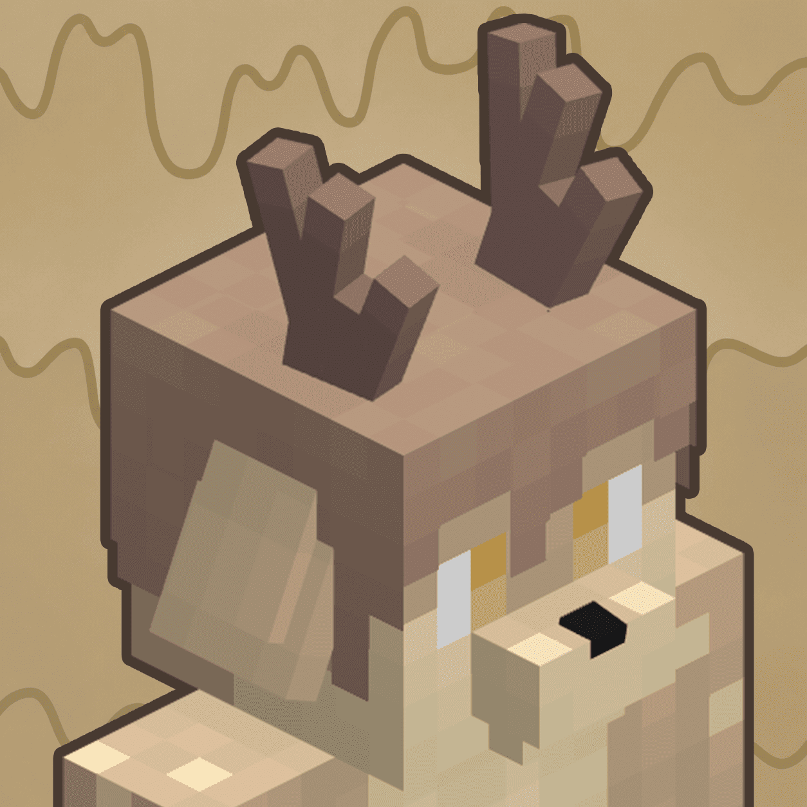

  

<h1 align="center">Changed: Synergy</h1>

  Friends, factions and camp life for Changed on Minecraft 1.20.1.

  
  
  
  

Changed: Synergy turns aggressive latex creatures into neighbors you can get along with. Answer a greeting, offer a gift and earn their trust over time. Creatures have persistent names, personalities and memories; friendships can lead to companion bonds, shared adventures and a home around the campfire.

**1.1.4 focuses on TrueTransfur integration.** With **TrueTransfur 2.0.0**, begin as a native latex creature, choose a species through an animated archive, speak in character and interact with other players in PLAYER or INSTINCT mode. TrueTransfur is optional: NPC relationships, camps and companion features work without it. Backward compatibility with **1.0.1** is retained; the expanded Instinct features require 2.0.0.

## Player guides

Start with the [guide directory](docs/README.md), or choose a topic:

| Guide | What it covers |
| --- | --- |
| [Social guide](docs/SOCIAL_GUIDE.md) · [中文](docs/SOCIAL_GUIDE.zh-CN.md) | First contact, feeding, gifts, friends, bonds and player interactions |
| [Player camps](docs/PLAYER_CAMP_GUIDE.md) | Establishing a camp, linking facilities, work, meals and travelling crews |
| [Native origins](docs/NATIVE_ORIGINS.md) | Choosing a human or creature origin and using the archive |
| [TrueTransfur and Instinct](docs/TRUETRANSFUR_INSTINCT_COMPAT.md) | Installation, visible bodies, control modes and player takeover |
| [Settings reference](docs/SETTINGS_GUIDE.md) · [中文](docs/SETTINGS_GUIDE.zh-CN.md) | Defaults, ranges and server-controlled options |
| [Server configuration](docs/SERVER_CONFIGURATION.md) | Operator commands, multiplayer settings and world rules |

See the [1.1.4-hotfix.2 release notes](docs/CHANGELOG-1.1.4-hotfix.2-full.md) for the latest fixes and the full changes since 1.1.3.

## What you can do

- **Build relationships over time.** Patting and feeding help with first contact; the first suitable wheel gift establishes acquaintance. Continued care and gifts deepen friendship. Full affection and a species-themed token unlock a first bond. Bonds can be ended without erasing friendship and renewed later.
- **Begin as a native latex creature.** Choose an eligible species or a human origin from the archive. Native identity, faction citizenship and a creature name persist. The archive supports category random choices and a fully random choice from its available records.
- **Interact with real players.** Native players can use nearby role speech, expressions, gifts and mutually confirmed friendships. Language understanding follows the same rules as NPC dialogue. Instinct bodies represent their actual players rather than separate social NPCs.
- **Build a camp.** Claim a campfire, link beds, rest points and containers, then invite trusted adult friends. Assign gathering, hunting, farming, cooking or hauling, with optional backup jobs. Shared meals bring residents around the campfire.
- **Take a crew along.** Choose Combat, Mining, Gathering or Hunting. Workers finish nearby tasks, keep real products in accessible Work Cargo, then resume following. Supplied pickaxes and fishing rods retain their useful properties.
- **Explore factions and communities.** Regional reputation, alliances, wild outposts, provisioner trades and remembered encounters influence creature behavior. Rival reputations are linked by default; servers can make them independent.
- **Negotiate and cooperate.** Supported creatures offer wrapping, rescue, rest, shore waiting, riding and revival. Takeover, release and transfur outcomes depend on the encounter and server settings. Companion wrapping and rescue do not require Addon Plus.
- **Configure the experience.** Server settings, world rules and client visuals are separate. Operators can tune relationships, camp limits, work areas, item restrictions, wild-outpost placement and AI scheduling.

## Downloads and requirements

- [Modrinth](https://modrinth.com/mod/changed-synergy)
- [CurseForge](https://www.curseforge.com/minecraft/mc-mods/changed-synergy)
- [GitHub releases](https://github.com/ParkaBird/changed-synergy/releases)

| Component | Supported version | Required |
| --- | --- | --- |
| Minecraft | 1.20.1 | Yes |
| Forge | 47.4.x | Yes |
| Changed | 0.15.7 | Yes |
| TrueTransfur | 2.0.0; backward compatibility with 1.0.1 | For native origins and TrueTransfur features |
| Mixin Args | 1.0 or newer | When using TrueTransfur 2.0.0 |
| Changed Addon Plus | 2.9.2c | No |
| Changed Vanilla | 1.0.1 | No |
| Changed Extras | 1.1.8b | No |
| Farmer's Delight | 1.3.4 | No |
| Domestication Innovation | 1.7.1 | No |

The [compatibility guide](COMPATIBILITY.md) covers other integrations and their limits. Optional mods are not bundled.

## Installation and getting started

1. Install Forge 47.4.x for Minecraft 1.20.1.
2. Put Changed 0.15.7 and one Synergy JAR in the instance's `mods` folder.
3. For native origins and Instinct gameplay, add TrueTransfur 2.0.0 and its required Mixin Args dependency. Add other integrations if wanted.
4. In multiplayer, install the same Synergy build and the relevant dependencies on the server and every client.

Back up important worlds before updating. For an existing world, review the server's **Starting Origin Selection** rule and use the [native-origin guide](docs/NATIVE_ORIGINS.md) to configure selection.

To start a camp, look at a placed campfire and use `/changedsynergy outpost create`, or choose **Establish Camp** on the relationship wheel. Look at a functional block and use `/changedsynergy outpost link`. Beds provide sleeping places; pillows, office chairs and tall cardboard boxes provide rest points. New members need Close friendship. See the [camp guide](docs/PLAYER_CAMP_GUIDE.md) for the full setup and orders.

For gameplay settings, open **Server Settings**, **World Rules** or **Client Visuals** in the configuration screen. Multiplayer gameplay values come from the server. Operators can use `/changedsynergy config categories`, `get`, `set` and `reset`; see [server configuration](docs/SERVER_CONFIGURATION.md).

## Source and contributing

Java 17 is required. Run `./gradlew build`, or `gradlew.bat build` on Windows. Release and source JARs are written to `build/libs`. See [building](docs/BUILDING.md), [architecture](docs/ARCHITECTURE.md) and [contributing](CONTRIBUTING.md) for development details.

- [Changelog](CHANGELOG.md)
- [Known limitations](KNOWN_ISSUES.md)
- [Performance controls](docs/PERFORMANCE.md)
- [Third-party notices](THIRD_PARTY_NOTICES.md)

## Support and credits

Report reproducible bugs through the [issue tracker](https://github.com/ParkaBird/changed-synergy/issues), including `latest.log` or the crash report, exact mod versions and reproduction steps. Join the [Changed: Synergy Discord](https://discord.gg/3yscxe2YgN) for feedback and discussion.

Changed: Synergy is developed by ParkaBird. Thanks to Nic, Crossader and Sword for dialogue and localization, and to TrueTransfur's author for collaboration, testing and Russian localization. This is an unofficial addon, not affiliated with the creators of Changed or Mojang Studios.

Generative AI assisted with parts of the English and Chinese text and code; ParkaBird reviewed, edited, integrated and tested the work. Artwork, textures, models, screenshots and promotional images are not AI-generated. See [AI disclosure](AI_DISCLOSURE.md).

Licensed under [GPL-3.0-or-later](LICENSE.txt).
