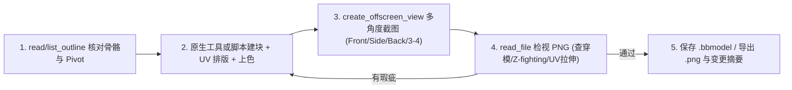

# Changed: Synergy Blockbench MCP 建模与环境上手指南

> **适用场景**：在项目根目录开启新对话、通过 MCP 操控桌面端 Blockbench 完成实体/服饰建模、UV 排版、像素绘制、多机位自审与导出交付。  
> **建议阅读顺序**：先读第 1~3 节确认工作区与 MCP 连通方式，再按第 4~6 节建模与自审。

---

## 1. 工作区布局与文件边界

### 1.1 双检出目录约定（重要）
本机可能存在两份仓库检出，请先核对当前会话的工作目录，**切勿互相覆盖或跨目录同步**：
- **`d:\changed-synergy-1.20.1`**：Antigravity 默认打开的工作区根目录（本指南所在目录）。
- **`D:\Minecraft Mods\changed-synergy-1.20.1`**：主开发与打包检出；其根目录 `AGENTS.md` 规定交付物通常归档在 `D:\Minecraft Mods\outputs\`，双检出各自独立工作。

### 1.2 建模相关核心目录与参考源
| 目录 / 文件 | 用途说明 |
| :--- | :--- |
| `.codex-tmp/changed-vanilla-source/3dmodels/*.bbmodel` | Changed 原版实体 `.bbmodel` 参考工程（如 `LatexFox.bbmodel`、`LatexCat.bbmodel` 等，适合对照骨骼原点与比例） |
| `src/main/java/net/parkabird/changedsynergy/client/model/` | 现有实体与服饰 Java `LayerDefinition`（如 `LatexSpottedHyenaModel`、`LatexEagleOwlModel`、`SynergyFemaleOutfitLayers`、`DesertOutfitLayers`、`ForestCanopyLayers`、`HyenaTrailclothLayers`） |
| `src/main/resources/assets/changed_synergy/textures/` | 现有生物与服饰 `.png` 贴图资源（含 `models/` 子目录） |
| `Blockbench Models/` | 项目内预留的模型目录（当前可能为空；历史活体工程归档多位于 `D:\Minecraft Mods\outputs\`） |
| `tools/` | Python / PowerShell 模型导入、服饰派生与校验脚本（详见第 4.3 节） |
| `docs/FEMALE_MODEL_AND_CLOTHING.md` / `docs/LATEX_EAGLE_OWL.md` | 雌性体型、雕鸮与服饰系统的设计约束文档 |

### 1.3 职责与修改红线
- **推荐产出范围**：`.bbmodel` 工程文件、`.png` 像素贴图、多角度渲染检查图、一次性自动化脚本（放在当前对话自己的 `scratch/` 临时目录，不留垃圾文件在仓库里）。
- **避免随意修改**：`src/main/java/**`（非模型生成的业务逻辑）、`build.gradle`、`settings.gradle`、`src/main/resources/META-INF/**` 以及已编排的剧情/社区文本资源。
- **代码联动**：若新建模型需要接入渲染器、Mixin 或物品注册，仅当用户明确要求同步进模组代码时才调用 `tools/import_*.py` 或更新 `client/model/*Layers.java`，否则只交付 `.bbmodel`、`.png` 与骨骼/参数摘要。

---

## 2. Blockbench MCP 连接架构与调用方式

### 2.1 运行时实况
- **桌面宿主**：`Blockbench.exe`（实测版本 `5.2.2`，Windows desktop）
- **MCP 插件**：`%APPDATA%\Blockbench\plugins\mcp.js`（实测版本 `v1.10.1`）
- **监听端点**：`http://127.0.0.1:3000/bb-mcp`（JSON-RPC 2.0 over HTTP / SSE，需先 `initialize` 获取响应头 `mcp-session-id` 并发送 `notifications/initialized`）

> [!NOTE]
> 如果新对话的 IDE / Agent 已在全局 MCP 配置里挂载了 `http://127.0.0.1:3000/bb-mcp`，你可以直接调用原生 MCP 工具；如果未挂载（工具列表里看不到 Blockbench 工具），**不要依赖其他旧对话 `brain/` 目录下的临时脚本**，直接在当前对话的 `scratch/` 目录写入下面这个无外部依赖的 Python 调用器即可。

### 2.2 自包含无依赖 CLI 调用器（未挂原生 MCP 时使用）
将下方脚本保存为当前对话 `scratch/bb_mcp.py` 即可复用（自动握手 `mcp-session-id`、解析 SSE/JSON 响应、支持 `-SaveImage` 保存截图）：

```python
import argparse, base64, json, urllib.request
from pathlib import Path

URL = "http://127.0.0.1:3000/bb-mcp"

def rpc(payload, sid=None, timeout=60):
    headers = {"Accept": "application/json, text/event-stream", "Content-Type": "application/json"}
    if sid:
        headers["mcp-session-id"] = sid
    req = urllib.request.Request(URL, data=json.dumps(payload).encode("utf-8"), headers=headers)
    with urllib.request.urlopen(req, timeout=timeout) as res:
        raw = res.read().decode("utf-8", "replace")
        for line in raw.splitlines():
            if line.startswith("data: "):
                raw = line[6:]
                break
        return res.headers.get("mcp-session-id"), (json.loads(raw) if raw.strip() else {})

def new_session():
    sid, _ = rpc({"jsonrpc":"2.0","id":0,"method":"initialize","params":{"protocolVersion":"2025-03-26","capabilities":{},"clientInfo":{"name":"bb-cli","version":"1.0"}}})
    try:
        rpc({"jsonrpc":"2.0","method":"notifications/initialized"}, sid)
    except Exception:
        pass
    return sid

def main():
    p = argparse.ArgumentParser()
    p.add_argument("tool")
    p.add_argument("--args", default="{}")
    p.add_argument("--js-file")
    p.add_argument("--save-image")
    args = p.parse_args()

    tool_args = {"code": Path(args.js_file).read_text(encoding="utf-8")} if args.js_file else json.loads(args.args)
    sid = new_session()
    _, resp = rpc({"jsonrpc":"2.0","id":1,"method":"tools/call","params":{"name":args.tool,"arguments":tool_args}}, sid)
    if "error" in resp:
        raise SystemExit(f"RPC ERROR: {resp['error']}")
    img_idx = 0
    for item in resp.get("result", {}).get("content", []):
        if item.get("type") == "image" and args.save_image:
            out = Path(args.save_image)
            if img_idx > 0:
                out = out.with_stem(f"{out.stem}_{img_idx}")
            out.write_bytes(base64.b64decode(item["data"]))
            print(f"IMAGE saved: {out}")
            img_idx += 1
        elif item.get("type") == "text":
            print(item["text"])
        else:
            print(json.dumps(item, ensure_ascii=False)[:400])

if __name__ == "__main__":
    main()
```

快速连通自检（接手新对话第一条命令）：
```powershell
py "<your_scratch_dir>\bb_mcp.py" get_capabilities
py "<your_scratch_dir>\bb_mcp.py" get_project_info
```

---

## 3. 原生 MCP 工具清单与使用策略（共 76 个工具）

Blockbench `mcp.js v1.10.1` 提供了完整的原生编辑工具。**原则：优先使用可撤销（Undoable）的原生工具；仅在需要批量像素绘制、读取本地目录或导出自定义 JSON 检查时使用 `risky_eval`。**

### 3.1 按功能分组速查
- **环境与工程状态**：
  `get_capabilities`、`get_project_info`、`create_project`、`list_modes`、`set_mode`、`get_undo_stack`、`save_checkpoint`
- **大纲与方块/骨骼操作**：
  `list_outline`、`find_elements_by_criteria`、`get_selection`、`select_all_of_type`、`filter_by_material`、`place_cube`、`modify_cube`、`remove_element`、`duplicate_element`、`rename_element`、`add_group`、`flip_in_place`、`knife_cut_cube`、`slice_cubes_to_block_grid`、`inspect_block_bounds`
- **UV 与像素贴图绘制**：
  `get_cube_uv`、`set_cube_uv`、`list_textures`、`get_texture`、`create_texture`、`apply_texture`、`activate_texture`、`delete_texture`、`color_picker_tool`、`paint_settings`、`paint_with_brush`、`create_brush_preset`、`load_brush_preset`、`texture_selection`、`texture_layer_management`
- **PBR 材质与 Bedrock 粒子（通常仅 Bedrock 格式使用）**：
  `create_pbr_material`、`configure_material`、`list_materials`、`get_material_info`、`import_texture_set`、`assign_texture_channel`、`save_material_config`、`list_particle_presets`、`create_particle_effect`、`update_particle_effect`、`list_particle_effects`、`manage_particle_keyframes`、`export_particle_pack`
- **动画与骨骼绑定**：
  `bone_rigging`、`create_animation`、`manage_keyframes`、`animation_graph_editor`、`batch_keyframe_operations`、`animation_timeline`、`animation_copy_paste`、`variable_placeholders`、`list_molang_variables`、`set_ik_controller`、`geckolib_list_easings`
- **视口与截图自审（推荐离屏视口）**：
  `list_views`、`create_offscreen_view`、`resize_offscreen_view`、`delete_offscreen_view`、`set_camera_angle`、`capture_screenshot`、`capture_app_screenshot`、`get_average_fps`
- **导入导出与底层调用**：
  `list_export_formats`、`export_model`、`from_geo_json`、`trigger_action`、`emulate_clicks`、`risky_eval`

### 3.2 关键注意事项（实测经验）
1. **工具可用性随编辑器标签页（Mode）变化**：`get_capabilities` 明确提示部分工具受当前 Mode 控制；调用绘制工具前应先 `list_modes` 并用 `set_mode` 切换到 `paint`（编辑建模用 `edit`，动画用 `animate`）。
2. **`create_offscreen_view` 避免打扰用户视口**：截图自审时建议新建离屏视口，用 `set_camera_angle` 转到正面/侧面/背面/3/4 视角后 `capture_screenshot` 保存为 PNG，审完用 `delete_offscreen_view` 释放 WebGL 上下文，避免频繁把用户正在操作的视口相机拽跑。
3. **`risky_eval` 无撤销栈（Does not create an Undo step）**：执行大批量修改前，建议先调用 `save_checkpoint` 或备份 `.bbmodel`。
4. **Windows 无头批量调用注意**：在 PowerShell 中向工具传多行 JS/JSON 时，优先落盘为脚本文件再用 `--js-file` / `--args` 传入，避免引号转义丢失。

---

## 4. `modded_entity` 格式硬红线与项目导入流水线

Changed 及 ChangedSynergy 的实体/服饰使用 Forge `modded_entity`（Mojang 1.20.1 `MeshDefinition` / `PartDefinition`），**不是 Bedrock 几何格式**。

### 4.1 宿主声明与导入器硬约束
根据 `get_capabilities` 对 `modded_entity` 的特性声明以及仓库 `tools/import_*.py` 源码断言，必须严格遵守：
1. **工程格式**：`meta.model_format == "modded_entity"` 且 `modded_entity_flip_y == true`。
2. **强制 Box UV**：`box_uv == true`（`optional_box_uv: false`、`uv_rotation: false`、`meshes: false`、`locators: false`）。
3. **禁止缩放拉伸**：所有 cube 的 `stretch` 必须为 `[1, 1, 1]`（否则 `import_spotted_hyena_models.py` / `import_hyena_trailcloth.py` 的 `assert` 直接失败）。
4. **单贴图规则**：`single_texture: true`，所有被导出方块 Faces 绑定到同一张主图集（例如 `import_forest_canopy_outfit.py` 强制校验 `faces[*].texture == 0`）。常见分辨率为 `128x128`（Desert 多体型共绘服饰图集为 `256x128`）。
5. **非导出参考层隔离**：用于对照解剖的参考身体/眼位预览层，其 group 或元素务必设为 `export: false`（`import_spotted_hyena_models.py` 也会过滤 `NOT_EXPORTED`）。
6. **负尺寸禁止**：cube 从 `from` 到 `to` 不能出现负数跨度，对称翻转优先使用原生 `flip_in_place` 或 `cube.roll()` 规范化。
7. **薄片防消失与 Z-fighting**：零厚度平面方块在 `import_eagle_owl_assets.py` 中会自动补 `inflate >= 0.0125`；建模时也建议给紧身贴片设置最小 `0.15~0.25` 膨胀避开身体表面 Z-fighting。

### 4.2 特殊命名与自定义扩展字段
- **静态立方体防动画误绑**：导出脚本会把普通 cube 转成 `cube_N_r1` 或 `<CubeName>_r1`，使 EMF / Fresh Moves 不会把它误认作活动骨骼。
- **多节尾巴关节包装**：`TailPrimary`、`TailSecondary`、`TailTertiary` 在 `import_spotted_hyena_models.py` 中会自动包一层 `<Name>_bind_r1` 静态偏移子节点来承载初始旋转角。
- **隐藏内壁面（`synergy_hidden_faces`）**：服饰或分段躯干在接缝处需要剔除内盖面时（避免裤腰/上衣横隔板穿帮），可在 `.bbmodel` 元素上记录 `synergy_hidden_faces`（如 `["up"]`、`["down"]`），`import_hyena_trailcloth.py` / `adapt_synergy_female_outfits.py` 会自动生成 `((CubeListBuilderExtender)...).removeLastFaces(Direction.UP / DOWN).finish()`。

### 4.3 仓库现有模型管线脚本（位于 `tools/`）
| 脚本 | 职责 |
| :--- | :--- |
| `tools/import_spotted_hyena_models.py` | 将 box-UV `modded_entity` `.bbmodel` 转换为 Java `LayerDefinition`（处理 Y 轴翻转、Pivot 偏移与角度反号） |
| `tools/import_hyena_trailcloth.py` | 拆分 Upper/Lower 服装层、保留 `synergy_hidden_faces` 并自动补全非鬃毛体型的后背肩带像素 |
| `tools/import_forest_canopy_outfit.py` | 提取 `Outfit_*` 服装节点并校准头环高度以避让原生 Tall 眼睛上沿 |
| `tools/import_eagle_owl_assets.py` | 雕鸮本体、飞行服、双格栖木导出，自带重复方块去重与 `LeftEarTuftPivot` / `RightEarTuftPivot` 自动拆组 |
| `tools/import_desert_content.py` | Desert 五种体型共用的 `256x128` 服饰图集切分与 Leader 深蓝黄铜变色派生 |
| `tools/adapt_synergy_female_outfits.py` | 从原服饰工程非破坏性地派生 Synergy 雌性窄肩平胸收腰裁片（移除旧胸部突出部件） |
| `tools/export_latex_cover_models.ps1` | 档案 UI 封面与着色眼贴图导出流水线 |
| `tools/tests/archive-ui/Test-PackagedModelLinkage.ps1` / `tools/validate_release.py` | 打包模型链接检查与发布资源完整性验证 |

---

## 5. Changed / ChangedSynergy 骨骼与解剖规范

### 5.1 标准骨骼命名与职责（大小写严格敏感）
模型根节点默认对应 Java `PartPose` 原点 `[0, 24, 0]`（站立基准在 `Y = 0`，头顶约 `Y = 32`）。

| 骨骼名 | 说明 | 标准参考 Pivot (X, Y, Z) |
| :--- | :--- | :--- |
| `Head` | 头部基底（耳、吻部、喙、角、头饰全挂其下） | `[0, 24, 0]` |
| `Torso` | 躯干核心（背饰、风衣上身、翅膀与尾巴基节挂其下） | `[0, 24, 0]` |
| `LeftArm` / `RightArm` | 主手臂（标准 4px 宽；Synergy 雌性通常 3px 宽） | `[5, 22.5, 0]` / `[-5, 22.5, 0]` |
| `LeftArm2` / `RightArm2` | 蚕蛾（Silk Moth）等四臂生物下层副臂 | `[5, 17.5, 0]` / `[-5, 17.5, 0]` |
| `LeftLeg` / `RightLeg` | 大腿基节 | `[2.5, 13.5, 0]` / `[-2.5, 13.5, 0]` |
| `Tail` / `TailPrimary` | 尾巴基节（多节尾巴继续挂 `TailSecondary` -> `TailTertiary`...） | `[0, 14, 2]`（视物种调整） |

> 💡 修改既有生物服饰或衍生新模型时，先直接用 `list_outline` 读取当前工程或参考 `.bbmodel` 中的精确 Pivot，不要凭经验手猜。

### 5.2 特殊体型解剖要点
1. **反曲腿（Digitigrade Legs）**：必须级联 `LeftLeg` -> `LeftLowerLeg` -> `LeftFoot` -> `LeftPad`，每级 `origin` 精确压在关节转折轴心上。
2. **Synergy 雌性形体**：长发、分段微曲躯干、**平胸无凸起**（严禁添加突兀胸部凸块，旧服饰适配到 Synergy 雌性时需按 `adapt_synergy_female_outfits.py` 去掉突出层并用 `synergy_hidden_faces` 隐藏腰部接缝内盖）、3px 细臂（斑鬣狗除外，保留 4px 健壮四肢与鬃毛间隙）。
3. **四臂昆虫（Silk Moth）**：服饰上衣须兼容两对袖口与 `LeftArm2`/`RightArm2` 活动空间。
4. **雕鸮（Eagle Owl）**：包含喙部（`Snout`/`Nose`）、面盘与耳羽束（`LeftTuft` / `RightTuft` 与 Pivot）、可折叠翅膀（`LeftWing`/`RightWing` + `LeftFlight`/`RightFlight`）及可放下的飞行护目镜。
5. **跳鼠（Jerboa）**：聚拢大耳（含内耳粉肉薄贴片）、粉色爪垫与手掌细节、长细尾配尾簇流苏。

### 5.3 服饰膨胀经验值（`inflate`）
- 紧身内搭 / 绑带 / 护腕：`0.15 ~ 0.25`
- 外衣 / 罩袍 / 短裙：`0.35 ~ 0.50`
- 肩甲 / 腰封 / 护目镜 / 靴套：`0.60 ~ 0.80`

---

## 6. 视觉自审与像素美工标准工作流

### 6.1 像素贴图原则
- 使用锐利纯像素点阵，禁止任何模糊、抗锯齿或非预期的半透明羽化。
- 每个色区保留 3~4 阶明暗（高光点缀 -> 主本色 -> 暗部转折 -> 深色接缝线/轮廓）。

### 6.2 标准视觉闭环（推荐流程）


### 6.3 离屏多视角检查示例（不改变用户主视角）
如果通过 MCP 原生工具操作，按以下顺序调用：
1. `create_offscreen_view`（尺寸如 `1024x1024`）
2. 依次用 `set_camera_angle` 设置代表性视角（如正面 `[0, 17.5, -52]` 看向 `[0, 17, 0]`、左侧 `[-52, 17.5, 0]`、背面 `[28, 24, 48]`、3/4 轴测 `[-36, 26, -46]`）并执行 `capture_screenshot` 存盘
3. 用 `read_file` 逐张查看截图，检查肩部/胯部穿模、隐藏面漏底、像素接缝与对称度
4. `delete_offscreen_view` 清理离屏视图
5. 完成后如需打包校验，可在项目根运行 `py tools/validate_release.py` 检查资源合法性。
