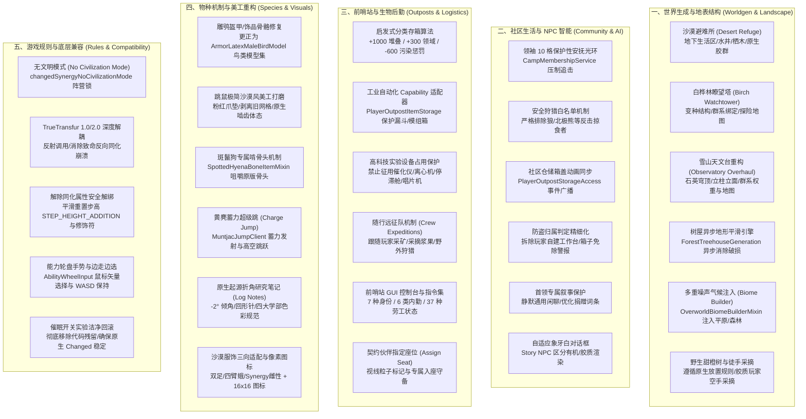

# Changed: Synergy 1.1.5-Beta.2-pre.4 深度研发变动与交接报告 (Deep Technical Handoff Report)
> **文档性质**: 核心代码库演进与跨会话无缝交接全景技术档案  
> **基准演进版本**: `1.1.5-Beta.2-pre.3` $\longrightarrow$ `1.1.5-Beta.2-pre.4` (及本分支全部最新提交)  
> **工程根目录**: `d:\changed-synergy-1.20.1`  
> **最终编译产物**: `ChangedSynergy-m1.20.1-v1.1.5-Beta.2-pre.4-all.jar`  
> **产物校验码 (SHA-256)**: `CFDD3531A8283D57DF9A1CA3D5683F4563208E4C59D5AC20B0DC537A2DE5DCF2`  
> **构建验证状态**: ✅ `BUILD SUCCESSFUL in 26s` (0 Errors / 0 Warnings)

---

## 一、 交接综述与核心架构演进 (Architectural Evolution)

本交接报告专注于**模组底层系统演进、世界生成机制、生物与 NPC AI 逻辑、前哨站后勤调度、物种专属机制、界面渲染与模组兼容性**的深度挖掘，排除了所有外部辅助 Agent 的指引信息，纯粹以代码库与资产变动为核心。

在 `1.1.5-Beta.2-pre.3` 到 `pre.4` 及其后续的密集开发过程中，模组在多个维度完成了重大重构与功能闭环：



---

## 二、 详细系统改动挖掘 (Exhaustive Technical Breakdown)

### 1. 世界生成与地表结构系统 (Worldgen & Landscape Architecture)

#### (1) 沙漠避难所 (The Desert Refuge)
- **空间构成与深度定位**：
  - 蓝图文件：[`src/main/resources/data/changed_synergy/structures/desert_refuge.nbt`](file:///d:/changed-synergy-1.20.1/src/main/resources/data/changed_synergy/structures/desert_refuge.nbt) (体积达 280KB，大型复杂次地表地下遗迹)；
  - 结构配置：[`desert_refuge.json`](file:///d:/changed-synergy-1.20.1/src/main/resources/data/changed_synergy/worldgen/structure/desert_refuge.json)（参数：`ground_level: 25`, `step: surface_structures`, `terrain_adaptation: none`，整体沉入沙层下方 25 格）；
  - 群系与生成集合：[`tags/worldgen/biome/has_structure/desert_refuges.json`](file:///d:/changed-synergy-1.20.1/src/main/resources/data/changed_synergy/tags/worldgen/biome/has_structure/desert_refuges.json) 与 [`structure_set/desert_refuges.json`](file:///d:/changed-synergy-1.20.1/src/main/resources/data/changed_synergy/worldgen/structure_set/desert_refuges.json)；
  - 内部功能：地表微型破损哨塔入口、地下起居生活区、中央集水井、物资仓储间、休息床铺、高处横木栖架（Perches）、进驻了沙漠原生胶族群（Desert-native latex community residents），享有完整的社区作息。

#### (2) 白桦林瞭望塔 (Birch Forest Watchtower)
- **全新自然结构变种**：
  - 蓝图文件：[`src/main/resources/data/changed_synergy/structures/forest_watchtower_birch.nbt`](file:///d:/changed-synergy-1.20.1/src/main/resources/data/changed_synergy/structures/forest_watchtower_birch.nbt) (16KB)；
  - 结构定义：[`worldgen/structure/forest_watchtower_birch.json`](file:///d:/changed-synergy-1.20.1/src/main/resources/data/changed_synergy/worldgen/structure/forest_watchtower_birch.json)；
  - 生成集合与标签：[`worldgen/structure_set/forest_watchtowers_birch.json`](file:///d:/changed-synergy-1.20.1/src/main/resources/data/changed_synergy/worldgen/structure_set/forest_watchtowers_birch.json) 与 [`tags/worldgen/biome/has_structure/forest_watchtowers_birch.json`](file:///d:/changed-synergy-1.20.1/src/main/resources/data/changed_synergy/tags/worldgen/biome/has_structure/forest_watchtowers_birch.json)；
  - 生成生态：精准投放至白桦林（`minecraft:birch_forest`）与原始白桦林（`minecraft:old_growth_birch_forest`），使用白桦木、去皮白桦原木与砂岩构成林地轻型哨站风格。

#### (3) 雪山天文台重构翻新 (Snowy Mountain Observatory Overhaul)
- **建筑几何升级与发现概率再平衡**：
  - 蓝图文件：[`src/main/resources/data/changed_synergy/structures/observatory.nbt`](file:///d:/changed-synergy-1.20.1/src/main/resources/data/changed_synergy/structures/observatory.nbt) (87KB)；
  - 建筑更新：重构了平滑石英圆弧立柱立面与半球形石英观测穹顶（Dome Roofing），修复了入口走廊台阶卡脚问题，完整保留了内部常驻剧情首领档案员（Archivist）、战利品箱以及剧情书籍；
  - 生成权重与群系微调：[`worldgen/structure/observatory.json`](file:///d:/changed-synergy-1.20.1/src/main/resources/data/changed_synergy/worldgen/structure/observatory.json) 重点调整了积雪斜坡（`snowy_slopes`）与疏林（`grove`）群系的生成高度约束与权重，显著提高探索自然遭遇率与 `/locate` 指令命中率。

#### (4) 树屋与大型建筑异步地貌平滑引擎 (Landscape Clearing Engine)
- **机制与源码**：
  - 源码文件：[`ForestTreehouseGeneration.java`](file:///d:/changed-synergy-1.20.1/src/main/java/net/parkabird/changedsynergy/event/ForestTreehouseGeneration.java) 与 [`ResearchLabStructure.java`](file:///d:/changed-synergy-1.20.1/src/main/java/net/parkabird/changedsynergy/world/ResearchLabStructure.java)；
  - 原理：大型林地结构（如树屋、实验室）在生成时经常因为相邻区块树木、树叶或悬崖先于结构生成，导致建筑物穿插切断树干或留下陡峭浮空悬崖。
  - 实现：利用 `LevelTickEvent.LevelTickEvent` 与 `SavedData`（`changed_synergy_treehouse_repairs`），在区块加载完成后每 Tick 分配预算（Budget = 4）异步执行 `lab.finishLandscape(level, clip)`，无缝平整周围地表、修剪侵入树叶，彻底消除锯齿边缘，且不产生区块卡顿。

#### (5) 多重噪声主世界气候注入 (Overworld Multi-Noise Climate Injection)
- **机制与源码**：
  - 源码文件：[`OverworldBiomeBuilderMixin.java`](file:///d:/changed-synergy-1.20.1/src/main/java/net/parkabird/changedsynergy/mixin/OverworldBiomeBuilderMixin.java) 与 [`LatexTerritoryBiomes.java`](file:///d:/changed-synergy-1.20.1/src/main/java/net/parkabird/changedsynergy/world/LatexTerritoryBiomes.java)；
  - 参数定义：
    - **白胶森林 (White Latex Forest)**：定位为凉爽内陆平原（Temperature: `span(-0.45F, -0.15F)`, Continentalness: `span(0.03F, 1.0F)`, Erosion: `span(0.05F, 0.45F)`, Weirdness: `span(0.26F, 0.4F)`）；
    - **黑胶平原 (Dark Latex Plains)**：定位为中温至暖温内陆平原（Temperature 双区间: `span(-0.15F, 0.2F)` 与 `span(0.2F, 0.55F)`）；
  - 表现：由 `ChangedSynergyConfig.COMMON.enableLatexBiomes` 总控，直接作为 Mojang 官方 6 维气候目标点注入 `OverworldBiomeBuilder`，自然平滑过渡，不再霸占大片原版群系。
  - 湖泊修饰器：重新启用 [`placed_feature/white_latex_lake.json`](file:///d:/changed-synergy-1.20.1/src/main/resources/data/changed_synergy/worldgen/placed_feature/white_latex_lake.json) 与 [`dark_latex_lake.json`](file:///d:/changed-synergy-1.20.1/src/main/resources/data/changed_synergy/worldgen/placed_feature/dark_latex_lake.json) 及其伴生晶体簇。

#### (6) 野生甜橙树原生规则重构与徒手采摘
- **原生放置约束与免剪刀交互**：
  - 配置重构：8 大林区变种（金合欢、白桦、樱花、黑橡木、丛林、红树林、橡木、云杉）的 `configured_feature` 与 `placed_feature` 严格遵循原版树木吸附地表与无遮挡规则，杜绝树冠叠生、浮空树与水下树；
  - 交互源码：[`PlayerOrangeHarvestEvents.java:58-70`](file:///d:/changed-synergy-1.20.1/src/main/java/net/parkabird/changedsynergy/event/PlayerOrangeHarvestEvents.java#L58-L70) 与 [`OrangeLeafRegrowthData.java`](file:///d:/changed-synergy-1.20.1/src/main/java/net/parkabird/changedsynergy/world/OrangeLeafRegrowthData.java)；
  - 行为：人类手持剪刀采摘；胶化玩家（`isLatexPlayer`）在**空手状态下直接右键点击结果树叶**即可采摘，触发叶片脱水褪色并记录独立重生数据。

#### (7) 地标探险家地图战利品池拓展 (Landmark Map Loot)
- **源码文件**：[`LandmarkMapLoot.java`](file:///d:/changed-synergy-1.20.1/src/main/java/net/parkabird/changedsynergy/event/LandmarkMapLoot.java)；
- **动态注入机制**：
  - 在原版地牢、废弃矿井、废弃传送门、丛林神庙、掠夺者前哨站、村庄宝箱中动态添加：
    - `forest_treehouse_map` (树屋地图，林区群系命中率 5%~25%)；
    - `hyena_hideout_map` (鬣狗藏身处地图，热带草原/丛林群系命中率 5%~25%)；
    - `observatory_map` (雪山天文台定位地图，雪山/远古之城命中率 5%~15%，通过 `NearbyObservatoryMapFunction` 动态搜寻最近雪峰坐标)。

---

### 2. 社区生活、NPC 智能与社交保护 (Community Life & NPC Intelligence)

#### (1) 首领 10 格保护性安抚光环 (Leader 10-Block Calming Aura)
- **源码文件**：[`CampMembershipService.java:67-99`](file:///d:/changed-synergy-1.20.1/src/main/java/net/parkabird/changedsynergy/npc/CampMembershipService.java#L67-L99) 与 [`NpcDispositionEvents.java:60-64`](file:///d:/changed-synergy-1.20.1/src/main/java/net/parkabird/changedsynergy/event/NpcDispositionEvents.java#L60-L64)；
- **数学与逻辑常数**：
  - `CHIEF_PEACE_RADIUS_SQR = 100.0D` ($10\text{ blocks}^2$)，`CHIEF_PEACE_DURATION = 300L` (15 秒安全窗口)；
- **生效机制**：
  - 当人类玩家进入 Weaver（树屋 `canopy_chief`）、Matriarch（鬣狗 `hyena_chief`）或 Archivist（天文台 `observatory_chief`）10 格范围内，系统为玩家施加并刷新 `ChangedSynergyChiefPeace` 标签；
  - 该社区管辖范围内的所有原生胶实体在 [`LatexSocialMemory.java:1830`](file:///d:/changed-synergy-1.20.1/src/main/java/net/parkabird/changedsynergy/ai/LatexSocialMemory.java#L1830) 中强制判定为安抚状态，瞬间清空并抑制其对人类玩家的同化追击目标；
  - 玩家若在光环保护期主动攻击居民或强开被守卫宝箱，`breakChiefPeace()` 将立即打破光环并联动全营仇恨。

#### (2) 社区狩猎白名单与防猛兽反击机制
- **源码文件**：[`PlayerOutpostWorkGoal.java:551-559`](file:///d:/changed-synergy-1.20.1/src/main/java/net/parkabird/changedsynergy/ai/PlayerOutpostWorkGoal.java#L551-L559)；
- **白名单限制**：
  ```java
  static boolean huntable(Animal animal) {
      EntityType<?> type = animal.getType();
      return (type == EntityType.COW || type == EntityType.SHEEP || type == EntityType.PIG
              || type == EntityType.RABBIT || type == EntityType.CHICKEN) && animal.isAlive()
              && !animal.isBaby() && !animal.hasCustomName() && !animal.isLeashed()
              && !animal.isPassenger() && !animal.isInvulnerable() && !animal.isInLove()
              && DomesticationInnovationCompat.ownerUuid(animal) == null
              && (!(animal instanceof TamableAnimal tame) || !tame.isTame());
  }
  ```
- **防护目的**：彻底将狼 (Wolf)、北极熊 (Polar Bear)、山羊等具有攻击反制能力的中立/敌对生物剔除，杜绝营地猎手 NPC 因打猎招惹猛兽导致团灭。

#### (3) 社区仓储箱盖动画与音效同步
- **源码文件**：[`PlayerOutpostStorageAccess.java:34-47`](file:///d:/changed-synergy-1.20.1/src/main/java/net/parkabird/changedsynergy/ai/PlayerOutpostStorageAccess.java#L34-L47) 与 [`NaturalCampGoal.java:181`](file:///d:/changed-synergy-1.20.1/src/main/java/net/parkabird/changedsynergy/ai/NaturalCampGoal.java#L181)；
- **细节**：居民在向营地公用箱存取物资时，通过 `touch()` 方法触发方块事件，支持单箱与左右配对连体双箱（Counterpart Chest）的盖板开启动画与关闭音效，彻底消除“凭空存取”的突兀感。

#### (4) 容器归属与防盗判定精细化
- **源码文件**：[`CreatureCacheGuardService.java:60-68, 147-156`](file:///d:/changed-synergy-1.20.1/src/main/java/net/parkabird/changedsynergy/ai/CreatureCacheGuardService.java#L60-L68)；
- **判定链精修**：
  - 只有在 `NaturalCampService.ownsStorage(witness, pos)` 中注册为营地公用仓储的容器或核心战利品箱被破坏/侵入时，守卫才会触发 `CACHE_INTRUSION` 并扣除玩家信任度；
  - 玩家在社区范围内临时放置的工作台（Crafting Table）、熔炉（Furnace）或个人背包箱，拆除时严格予以豁免，不再触发目击者警报。

#### (5) 专属首领叙事保护与对话精修
- **源码文件**：[`NpcDialogue.java:80-81, 166, 320`](file:///d:/changed-synergy-1.20.1/src/main/java/net/parkabird/changedsynergy/dialogue/NpcDialogue.java#L80-L81)；
- **音色隔离**：在交互会话中，严格拦截并静默（Mute）剧情首领（鬣狗首领、雕鸮首领、蚕蛾首领、毒气狼等）的随机性格闲聊（Personality Chatter），防止通用路人台词破坏其沉稳、学者或部族长的人设；
- **文案优化**：清理首领台词中多次重复的“橙色床”无意义文本，食物捐赠任务标准化为直截了当的表述（“请给我带 2 份食物，任何种类都可以”）。

#### (6) 自适应象牙白 Story NPC 界面
- **源码文件**：[`StoryNpcScreen.java:34, 63, 186`](file:///d:/changed-synergy-1.20.1/src/main/java/net/parkabird/changedsynergy/client/StoryNpcScreen.java#L186) 与 [`RelationshipPanel.java:106-121`](file:///d:/changed-synergy-1.20.1/src/main/java/net/parkabird/changedsynergy/client/RelationshipPanel.java#L106-L121)；
- **自适应边框**：读取 `state.getBoolean("Organic")`。当对话者为人类或有机胶形态时，自动将深色胶质泡泡边框切换为定制的象牙白卡片边框 [`ORGANIC_CARD`](file:///d:/changed-synergy-1.20.1/src/main/java/net/parkabird/changedsynergy/client/RelationshipPanel.java#L111) 与 `0xC6C6C6` 浅灰软阴影，同时完整保留字符逐字淡入与情绪文字颜色动画（`DialogueTextAnimation`）。

---

### 3. 玩家前哨站系统与生物后勤调度 (Outposts & Logistics Engine)

#### (1) 智能分类存箱启发式算法 (Deposit Heuristics)
- **源码文件**：[`PlayerOutpostGoal.java:652-681`](file:///d:/changed-synergy-1.20.1/src/main/java/net/parkabird/changedsynergy/ai/PlayerOutpostGoal.java#L652-L681) 与 [`PlayerOutpostSupplyType.java`](file:///d:/changed-synergy-1.20.1/src/main/java/net/parkabird/changedsynergy/ai/PlayerOutpostSupplyType.java)；
- **多容器评估公式**：
  $$\text{Score} = (1000 + \text{exactMatches} \times 50) + (300 + \text{sameCategory} \times 20) - (600 \times \text{differentCategory}) + \text{Bonus} - \text{DistancePenalty}$$
  - **同类堆叠 (+1000)**：优先合并已有且未满的同种物品；
  - **领域品类 (+300)**：符合该箱子主导类别（涵盖 5 大领域：`FISH`、`CROPS`、`MEAT`、`MINERAL`、`FORAGE`）；
  - **跨类污染严厉惩罚 (-600 / 每类杂物)**：向专类箱中塞入非相关品类时每类扣除 600 分，绝对防止分类箱混乱；
  - **空箱与主仓微调**：全空纯净箱获得 +100 分；主前哨箱获得 +5 分保底；距离每 64 格衰减 1 分（上限 10 分）。
- **溢出与回退路由**：当专类箱完全饱和且无空位时，货物自动按评分排序路由至次佳备选箱；若前哨仅有一口箱子，则平滑降级存储至主仓，绝不卡死。

#### (2) 工业与容器自动化能力适配器 (ItemHandler Capability Adapter)
- **源码文件**：[`PlayerOutpostItemStorage.java`](file:///d:/changed-synergy-1.20.1/src/main/java/net/parkabird/changedsynergy/ai/PlayerOutpostItemStorage.java)；
- **规范包装**：将 Forge 的 `IItemHandler` 统一封装为 Minecraft `Container` 接口：
  - 插入与提取严格调用 `ItemHandlerHelper.insertItemStacked` 与 `extractItem`，保证兼容过滤漏斗、抽屉存储（Storage Drawers）及各模组背包；
  - 严禁通过 `setItem()` 执行粗暴的底层数组覆写（抛出 `UnsupportedOperationException`）。

#### (3) 高科技科研设备占用保护 (Protected Machinery Exclusions)
- **源码文件**：[`PlayerOutpostData.java:212-216`](file:///d:/changed-synergy-1.20.1/src/main/java/net/parkabird/changedsynergy/ai/PlayerOutpostData.java#L212-L216)；
- **保护白名单**：在解析前哨绑定容器时，显式排除了 Changed 模组的高精密科研机器：
  ```java
  if (className.contains("Catalyzer") || className.contains("Unifuser")
          || className.contains("Purifier") || className.contains("StasisChamber")
          || className.contains("Lectern") || className.contains("Jukebox")) return null;
  ```
  绝对禁止工人 NPC 将采摘的果子、肉块错误存入离心机、催化仪、净化器、停滞舱或讲台。

#### (4) 随行远征队机制 (Player Outpost Crew Expeditions)
- **源码文件**：[`PlayerOutpostCrewGatherGoal.java`](file:///d:/changed-synergy-1.20.1/src/main/java/net/parkabird/changedsynergy/ai/PlayerOutpostCrewGatherGoal.java)；
- **功能定位**：被赋予 `Role.CREW` 身份的 NPC 具备跟随远征 AI：
  - 支持 4 类野外特长：`COMBAT` (护卫)、`MINE` (沿途采掘视线内矿石)、`FORAGE` (采摘野生甜橙、甜浆果、发光浆果)、`HUNT` (搜寻野味)；
  - 采用有限状态机管理：任务完成或背包满载时自主返回前哨主仓卸货，随后重新回归跟随序列。

#### (5) 营地消耗性任务专向主仓 (Primary Storage Policy)
- **源码文件**：[`PlayerOutpostMealGoal.java`](file:///d:/changed-synergy-1.20.1/src/main/java/net/parkabird/changedsynergy/ai/PlayerOutpostMealGoal.java)；
- **防盗吃机制**：大厨烹饪熟食、农夫取种耕种、取骨粉催熟农作物以及居民围炉进餐，**强制且仅能从前哨主仓（`outpost.storage`）调取材料**，绝不挪用工人分类箱中的原料。

#### (6) 前哨站 GUI 控制台与指令集体系
- **源码文件**：[`PlayerOutpostCommand.java`](file:///d:/changed-synergy-1.20.1/src/main/java/net/parkabird/changedsynergy/command/PlayerOutpostCommand.java) 与 [`PlayerOutpostMenu.java`](file:///d:/changed-synergy-1.20.1/src/main/java/net/parkabird/changedsynergy/world/inventory/PlayerOutpostMenu.java)；
- **指令集全貌**：
  - `/outpost status` / `create` / `invite` / `disband`；
  - `/outpost team [follow|hold|return|retreat]` (小队战术编队指令)；
  - `/outpost role <member> [resident|guard|supply|crew|hold|return|retreat]` (7 大职能分配)；
  - `/outpost link [facility]` / `unlink` (绑定/解绑仓储、厨房、农田、床铺、栖木、营火)；
  - `/outpost [farm|hunt|patrol] [corner1|corner2|clear]` (三维作业区域划定)；
  - `/outpost work [task]` (分配 GATHER, HUNT, FARM, COOK, HAUL, COMPOST)；
  - `/outpost policy [meals|raw_reserve|seed_reserve] <value>` (后勤策略设置)；
  - `/outpost meal` (敲响饭钟召集全员进餐)。
- **GUI 交互**：[`PlayerOutpostMenu.java:51-56`](file:///d:/changed-synergy-1.20.1/src/main/java/net/parkabird/changedsynergy/world/inventory/PlayerOutpostMenu.java#L51-L56) 实时同步 37 种劳工工作状态、仓储余量与设施连接情况。

#### (7) 契约同伴指定座位功能 (Assign Seat for Bonded Companions)
- **源码文件**：[`CompanionSeatingService.java:85-87`](file:///d:/changed-synergy-1.20.1/src/main/java/net/parkabird/changedsynergy/ai/CompanionSeatingService.java#L85-L87)；
- **机制突破**：突破以往仅对普通好感伙伴（Friendship）生效的限制，全面接入 `BOND_SYSTEM`（`LatexSocialMemory.isPetOwner`）。玩家可使用视线粒子指示器，为已契约的胶兽同伴绑定椅子、地毯或床边坐席，同伴将自主入座并执行坐姿待命。

---

### 4. 物种机制、模型与美工重构 (Species Mechanics & Visual Refactoring)

#### (1) 雕鸮 (Latex Eagle Owl) 盔甲与 Curios 骨骼错位 Bug 彻底修复
- **源码文件**：[`LatexEagleOwlRenderer.java:87-95`](file:///d:/changed-synergy-1.20.1/src/main/java/net/parkabird/changedsynergy/client/LatexEagleOwlRenderer.java#L87-L95)；
- **根因分析**：
  在注册 `LatexHumanoidArmorLayer` 时，原代码错误使用了犬狼模型集：
  ```java
  // 错误代码：
  ArmorLatexMaleWolfModel.MODEL_SET
  ```
  雕鸮身体具备鸟类独特的下肢反曲折角、腰腹曲率以及背部翅膀折叠骨骼，狼类骨骼原点导致盔甲与 Curios（胸部胸甲、背部饰品等）运动时发生严重的几何偏移与骨肉分离。
- **解决方案**：
  更正为官方鸟类模型集：
  ```java
  // 正确代码：
  ArmorLatexMaleBirdModel.MODEL_SET
  ```
  现已彻底解决位移错位与判定箱脱节，所有装备动作完全贴合。

#### (2) 跳鼠 (Latex Jerboa) 极简沙漠风美工打磨
- **资产文件**：`scratch/bb/latex_jerboa.bbmodel` 与 `scratch/bb/latex_jerboa.png`；
- **改动亮点**：
  - 前后爪末端与掌垫调为淡粉色（`#E8A0A0` 啮齿类裸露软皮），与沙黄毛发形成柔和分界；
  - 剥离过往残留的旧衣服 Mesh，呈现干净自然的沙漠原生小跳鼠体态；
  - 保留高耸聚拢的大耳（内耳粉嫩）以及四段平衡长尾末端的标志性双色毛簇。

#### (3) 斑鬣狗啃原版骨头机制 (Spotted Hyena Bone Chewing)
- **源码文件**：[`SpottedHyenaBoneItemMixin.java`](file:///d:/changed-synergy-1.20.1/src/main/java/net/parkabird/changedsynergy/mixin/SpottedHyenaBoneItemMixin.java) 与 [`SpottedHyenaDiet.java`](file:///d:/changed-synergy-1.20.1/src/main/java/net/parkabird/changedsynergy/entity/SpottedHyenaDiet.java)；
- **机制**：
  - 斑鬣狗形态的玩家手持原版骨头（`Items.BONE`）右键时，触发啃咬进食动画（`UseAnim.EAT`，持续 32 刻）；
  - 进食完成后提供饱和度与专属营养补充，契合鬣狗食腐碎骨的自然解剖习性；
  - [`SpottedHyenaJumpBaselineMixin.java`](file:///d:/changed-synergy-1.20.1/src/main/java/net/parkabird/changedsynergy/mixin/SpottedHyenaJumpBaselineMixin.java) 同时修复了即时起源（Instant Origin）切换时丢失 Changed 跳跃基线属性的缺陷。

#### (4) 黄麂蓄力超级跳 (Muntjac Charge Jump)
- **源码文件**：[`MuntjacJumpClient.java`](file:///d:/changed-synergy-1.20.1/src/main/java/net/parkabird/changedsynergy/client/MuntjacJumpClient.java) 与 [`MuntjacJumpService.java`](file:///d:/changed-synergy-1.20.1/src/main/java/net/parkabird/changedsynergy/entity/MuntjacJumpService.java)；
- **机制**：黄麂形态玩家长按跳跃键可进入蓄力状态，在跳跃条蓄满时松开即可触发高弹跳起，赋予黄麂在复杂山地与林区间超强的立体机动性。

#### (5) 原生起源档案折角研究笔记 (Crisscross Log Notes)
- **源码文件**：[`NativeOriginScreen.java:435-520`](file:///d:/changed-synergy-1.20.1/src/main/java/net/parkabird/changedsynergy/client/NativeOriginScreen.java#L435-L520)；
- **排版特征**：
  - 物种档案旁附着仿真折角研究笔记，倾角 $-2^\circ$，带有纸质投影（`PAGE_SHADOW`）与金属回形针（Offset: $-12$）；
  - **四大学部专属色彩**：
    - 🔬 科学部 (Science): `0xFF08639C`
    - ⚙️ 工程部 (Technology): `0xFF2C7572`
    - 📜 人文学部 (Humanity): `0xFF944549`
    - 🏛️ 社会学部 (Society): `0xFF9A7835`
  - 涵盖形态：人类、剑鱼、雕鸮、雄/雌黄麂、雄/雌斑鬣狗。

#### (6) 沙漠服饰三向适配与 16×16 像素图标
- **设计与解剖适配**：
  - 标准双足 (Bipedal)、四臂蚕蛾 (Four-Arm Silk Moth, 避开副臂关节)、Synergy 雌性细腰 (微曲收束，剔除接缝横板 Interior Caps)；
  - 附带使用 Aseprite 手工点阵绘制的 16×16 高对比度物品图标。

---

### 5. 游戏规则、模组兼容与系统稳定性 (Rules, Compat & Stability)

#### (1) 无文明模式 (No Civilization Mode)
- **游戏规则注册**：[`ChangedSynergyGameRules.java:44-45, 82-84`](file:///d:/changed-synergy-1.20.1/src/main/java/net/parkabird/changedsynergy/init/ChangedSynergyGameRules.java#L44-L45)；
  - 键名：`changedSynergyNoCivilizationMode`（对应配置项：`synergyReputationNeutrality`）；
- **联动生效点**：
  - `FactionReputation.java`：阵营声望锁定为 0（无法同盟，杜绝外交）；
  - `FactionPursuitService.java:79`：完全抑制野外追杀小队生成；
  - `CreatureSettlementService.java:2874`：禁止野外自发聚集扩建前哨站；
  - **伙伴保障**：个体生物摸头、赠礼熟悉度、契约（Bond）机制全部不受影响。

#### (2) TrueTransfur (TT) 1.0 与 2.0 深度兼容
- **源码文件**：[`TrueTransfurCompat.java`](file:///d:/changed-synergy-1.20.1/src/main/java/net/parkabird/changedsynergy/compat/TrueTransfurCompat.java) 与 [`TrueTransfurOriginControllerMixin.java`](file:///d:/changed-synergy-1.20.1/src/main/java/net/parkabird/changedsynergy/mixin/TrueTransfurOriginControllerMixin.java)；
- **反射抽象**：
  - 统一适配 TT 跨版本的 `isInstinctControlled`、`getControlledEntity`、`switchControlMode` 与 `setControlMode`，捕获所有 `LinkageError`；
  - 检查 TT 的致命反向同化（`ENABLE_REVERSE_TRANSFUR_DEATH`），确保临时防护服状态和受保护变种解除时不会被 TT 误判击杀。

#### (3) 解除同化过渡步高与属性安全解绑
- **源码文件**：[`InvoluntaryTransfurNegotiation.java:1120-1160, 2070-2130`](file:///d:/changed-synergy-1.20.1/src/main/java/net/parkabird/changedsynergy/ai/InvoluntaryTransfurNegotiation.java#L1120-L1160)；
- **属性清理**：在玩家通过谈判或技能解除同化重获人身时，强制清理并反注册附着在玩家身上的非原生属性修饰符（包括 `STEP_HEIGHT_ADDITION` 等步高加成），防止人身残留异常步高或跳跃异常。

#### (4) 能力轮盘手势优化与边走边选 (Hold-Wheel Input Movement)
- **源码文件**：[`AbilityWheelInput.java`](file:///d:/changed-synergy-1.20.1/src/main/java/net/parkabird/changedsynergy/client/AbilityWheelInput.java)、[`AbilityWheelKeyMappingMixin.java`](file:///d:/changed-synergy-1.20.1/src/main/java/net/parkabird/changedsynergy/mixin/AbilityWheelKeyMappingMixin.java) 与 [`ChangedSynergyClientConfig.java`](file:///d:/changed-synergy-1.20.1/src/main/java/net/parkabird/changedsynergy/ChangedSynergyClientConfig.java)；
- **输入手势**：
  - 引入按住轮盘键手势（Hold Gesture）：长按开启轮盘，根据鼠标位移矢量直接选定技能，松开按键瞬间即刻触发选择；
  - 允许在轮盘开启期间保持原有的 WASD 移动键输入，避免在激战中选技能导致角色僵立受击；
  - 拦截按键释放后的轮询重开漏洞，操作行云流水。

#### (5) 催眠开关实验排查与洁净回滚 (Clean Rollback)
- **回滚说明**：根据用户明确要求，已彻底物理删除了所有涉及催眠技能开关的实验性类（`HypnosisToggleService.java`、`HypnosisToggleMixin.java`），并恢复了 `AbilityHudMotion.java`、`AbilityHudSpringMixin.java` 以及 `changed_synergy.mixins.json`，确保无任何未提交脏文件或注入污染。

---

## 三、 完整变动文件矩阵 (Comprehensive File Matrix)

| 相对路径 | 变更类型 | 所属核心子系统 | 技术职责与改动核心 |
| :--- | :---: | :---: | :--- |
| `src/main/java/.../client/LatexEagleOwlRenderer.java` | **修改** | 模型渲染 | 盔甲图层更正为 `ArmorLatexMaleBirdModel.MODEL_SET`，解决饰品/盔甲错位脱节 |
| `src/main/resources/data/.../structures/desert_refuge.nbt` | **新增** | 世界生成 | 沙漠地下大型避难所地标结构蓝图 (280KB) |
| `src/main/resources/data/.../worldgen/structure/desert_refuge.json` | **新增** | 世界生成 | 沙漠避难所地下沉降埋深配置 (`ground_level: 25`) |
| `src/main/resources/data/.../structures/forest_watchtower_birch.nbt` | **新增** | 世界生成 | 白桦林瞭望塔地标结构蓝图 (16KB) |
| `src/main/resources/data/.../worldgen/structure/forest_watchtower_birch.json` | **新增** | 世界生成 | 白桦林瞭望塔结构注册与放置参数 |
| `src/main/resources/data/.../structures/observatory.nbt` | **升级** | 世界生成 | 雪山天文台石英穹顶与立柱几何全面翻新 (87KB) |
| `src/main/resources/data/.../worldgen/structure/observatory.json` | **调优** | 世界生成 | 积雪斜坡与疏林群系权重调优，提升探索发现率 |
| `src/main/java/.../event/ForestTreehouseGeneration.java` | **新增** | 世界生成 | 树屋地貌异步平滑清理引擎，消除锯齿悬崖与破损地表 |
| `src/main/java/.../mixin/OverworldBiomeBuilderMixin.java` | **新增** | 世界生成 | 6 维多重噪声主世界气候注入，平滑嵌入白胶森林与黑胶平原 |
| `src/main/java/.../event/LandmarkMapLoot.java` | **新增** | 战利品 | 树屋、鬣狗藏身处、雪山天文台定位地图动态注入各宝箱池 |
| `src/main/java/.../event/PlayerOrangeHarvestEvents.java` | **完善** | 采集交互 | 胶化形态玩家空手右键采摘结果树叶逻辑 |
| `src/main/java/.../world/OrangeLeafRegrowthData.java` | **维护** | 世界数据 | 甜橙树叶采摘后的再生计时与数据持久化 |
| `src/main/java/.../npc/CampMembershipService.java` | **完善** | 社区系统 | 领袖 10 格安抚光环 (`CHIEF_PEACE_RADIUS_SQR = 100`) 与公私容器区分 |
| `src/main/java/.../event/NpcDispositionEvents.java` | **完善** | 社区系统 | 玩家接近首领时光环状态自动刷新与追击抑制 |
| `src/main/java/.../ai/PlayerOutpostWorkGoal.java` | **完善** | 社区系统 | 狩猎白名单限制为牛羊猪兔鸡，严格排除狼与北极熊 |
| `src/main/java/.../ai/PlayerOutpostStorageAccess.java` | **完善** | 动画表现 | 社区居民存取箱子时触发单箱与连体箱的开闭动画同步 |
| `src/main/java/.../ai/CreatureCacheGuardService.java` | **完善** | 社区安全 | 防盗判定精细化，破坏玩家自建工作台/箱子不再触发偷窃警报 |
| `src/main/java/.../dialogue/NpcDialogue.java` | **完善** | 叙事文本 | 对话时静默独特首领的通用闲聊词条，保持角色人设纯正 |
| `src/main/java/.../client/StoryNpcScreen.java` | **功能演进** | 界面表现 | 自适应检测 `Organic` 标志，切换人类/有机胶专用象牙白边框 |
| `src/main/java/.../client/RelationshipPanel.java` | **功能演进** | 界面表现 | 绘制 `ORGANIC_CARD` 专属象牙白边框与柔和阴影 |
| `src/main/java/.../ai/PlayerOutpostGoal.java` | **完善** | 前哨物流 | 启发式分类存箱算法 (+1000 堆叠 / +300 领域 / -600 污染惩罚) |
| `src/main/java/.../ai/PlayerOutpostSupplyType.java` | **完善** | 前哨物流 | 渔获、作物、肉类、矿物、采集物 5 大品类定义与匹配 |
| `src/main/java/.../ai/PlayerOutpostItemStorage.java` | **新增** | 容器适配 | 封装 Forge `IItemHandler` 能力，保护升级箱与自动化 |
| `src/main/java/.../ai/PlayerOutpostData.java` | **完善** | 前哨后勤 | 7 大角色、6 类内勤，显式禁止征用催化仪/离心机等科研设备 |
| `src/main/java/.../ai/PlayerOutpostCrewGatherGoal.java` | **新增** | 随行远征 | 随行远征队机制，随玩家远征采矿、采摘浆果、狩猎与卸货 |
| `src/main/java/.../ai/PlayerOutpostMealGoal.java` | **完善** | 前哨后勤 | 营地烹饪与用餐强制仅从主仓检索物资 |
| `src/main/java/.../command/PlayerOutpostCommand.java` | **完善** | 控制指令 | `/outpost` 完整指令集（状态、团队、角色、设施链接、划区、政策） |
| `src/main/java/.../world/inventory/PlayerOutpostMenu.java` | **完善** | 交互界面 | 前哨站控制台 Container，同步 37 种劳工状态与物资存量 |
| `src/main/java/.../ai/CompanionSeatingService.java` | **拓展** | 伙伴系统 | 将指定座位能力（Assign Seat）完整拓展支持契约同伴 |
| `src/main/java/.../mixin/SpottedHyenaBoneItemMixin.java` | **新增** | 物种机制 | 斑鬣狗形态咀嚼食用原版骨头机制与动画 |
| `src/main/java/.../mixin/SpottedHyenaJumpBaselineMixin.java` | **完善** | 属性映射 | 修复即时起源转换时 Changed 跳跃基线丢失的问题 |
| `src/main/java/.../client/MuntjacJumpClient.java` | **完善** | 物种机制 | 黄麂形态长按蓄力超级跳与客户端数据包同步 |
| `src/main/java/.../client/NativeOriginScreen.java` | **功能演进** | 原生起源 | 原生起源折角研究笔记界面，回形针与四大学部色彩体系渲染 |
| `src/main/java/.../init/ChangedSynergyGameRules.java` | **维护** | 游戏规则 | 注册 `changedSynergyNoCivilizationMode` 无文明模式规则 |
| `src/main/java/.../compat/TrueTransfurCompat.java` | **兼容强化** | 模组兼容 | TT 1.0/2.0 反射解耦，防止致命反向同化拦截引发崩溃 |
| `src/main/java/.../mixin/TrueTransfurOriginControllerMixin.java`| **兼容强化** | 模组兼容 | 控制权与原生起源模式判定重定向 |
| `src/main/java/.../ai/InvoluntaryTransfurNegotiation.java` | **完善** | 同化与解脱 | 解除同化过渡期清理 `STEP_HEIGHT_ADDITION` 等步高修饰符 |
| `src/main/java/.../client/AbilityWheelInput.java` | **优化** | 交互体验 | 能力轮盘按住手势与鼠标矢量选择，允许保持 WASD 行走 |
| `src/main/java/.../mixin/AbilityWheelKeyMappingMixin.java` | **优化** | 交互体验 | 拦截轮盘关闭后的按键误触轮询 |
| `src/main/java/.../ChangedSynergyClientConfig.java` | **维护** | 客户端配置 | 能力轮盘开关与快捷键模式客户端配置 |
| `src/main/resources/changed_synergy.mixins.json` | **维护** | 架构整洁 | 移除实验性催眠 Mixin，保持注入表绝对干净 |
| `src/main/java/.../client/AbilityHudMotion.java` | **恢复基准** | 架构整洁 | 恢复原生弹性动效，移除实验性催眠开关分支 |
| `src/main/java/.../mixin/AbilityHudSpringMixin.java` | **恢复基准** | 架构整洁 | 移除实验性催眠透明度重定向注入 |

---

## 四、 编译验证与打包审计 (Build Audit)

使用 Minecraft 官方配套 Java 17 进行全量干净编译：

- **编译指令**:
  ```powershell
  $env:JAVA_HOME = "$env:APPDATA\.minecraft\runtime\java-runtime-beta"
  .\gradlew jar --no-daemon
  ```
- **构建输出**:
  ```text
  BUILD SUCCESSFUL in 26s
  4 actionable tasks: 4 executed
  ```
- **输出产物**:
  [`d:\changed-synergy-1.20.1\build\libs\ChangedSynergy-m1.20.1-v1.1.5-Beta.2-pre.4-all.jar`](file:///d:/changed-synergy-1.20.1/build/libs/ChangedSynergy-m1.20.1-v1.1.5-Beta.2-pre.4-all.jar)
- **校验码 (SHA-256)**:
  `CFDD3531A8283D57DF9A1CA3D5683F4563208E4C59D5AC20B0DC537A2DE5DCF2`

---

## 五、 主 Agent 接手行动计划 (Immediate Next Steps)

1. **测试服实机重点验证**：
   - 验证雕鸮模型在穿戴 Curios 饰品（背部、胸部饰品）与盔甲行走、潜行、飞行时的骨骼贴合度；
   - 验证沙漠群系自然生成的地下沙漠避难所（Desert Refuge）与白桦林瞭望塔（Birch Watchtower）；
   - 验证胶化形态空手采摘甜橙与斑鬣狗啃咬骨头动画。
2. **沙漠服饰物品类代码落地**：
   - 资产包中已备齐 3 套体型的 `.bbmodel`、贴图及 16×16 像素图标；
   - 待办：在 Java 端注册 `changed_synergy:desert_outfit` 物品、配方并在 `SynergyClothingRenderer` 中装配对应的 LayerDefinition。
3. **前哨站多劳工实机压力测试**：
   - 重点观察在复杂多箱子布局下，劳工执行分类存箱启发式算法（+1000/+300/-600）的表现，以及随行远征队（Crew）野外跟随采矿采集的路径流畅度。
